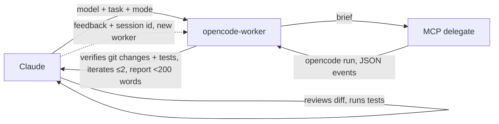

# Claudelegate

A Claude Code plugin that hands scoped coding work to any model in your OpenCode install (Grok, Kimi, GLM, Qwen, DeepSeek, and others) so Claude plans and reviews while a cheaper model writes the code.

```text
you    ▸ /opencode grok 4.7 -- add input validation to the signup form
claude ▸ spawns opencode-worker (model: grok 4.7, mode: write)
worker ▸ MCP delegate → session ses_abc, 3 files changed, report
claude ▸ reads git diff, runs tests, reports which model did what and a verdict
```

## Install

```text
/plugin marketplace add lehcode/claudelegate
/plugin install claudelegate@claudelegate
```

To use a local clone, add it as a directory marketplace: `/plugin marketplace add /path/to/clone`. After pulling changes, refresh the plugin (`/plugin` → update, or reinstall).

### Requirements

Claudelegate works in Claude Code only. Its hooks, agent and local MCP server don't load on claude.ai or in Cowork.

- OpenCode v2 or later with at least one provider configured (verified on 2.1.2)
- Bun 1.1 or later, which runs the MCP server
- `jq` on PATH
- `git`

## Usage

Say "Use kimi k3 via opencode to add tests for `src/date.ts`." Or use the slash command: `/opencode <model> -- <task>`. For example: `/opencode deepseek v4 flash -- write unit tests for src/date.ts`. You can also spawn the `claudelegate:opencode-worker` agent from a workflow with the model and task in its prompt. Claude does this on its own for ordinary implementation work.

## How it works



The main thread spawns the background `opencode-worker` (Haiku, no edit tools). The worker resolves model and mode (read-only tasks pass `auto: false`), writes a self-contained brief, calls the MCP `delegate` tool, checks the git diff and runs tests or build, retries at most twice with the same session, otherwise reports reject. Its report has model, session id, changed files, verification and verdict, under 200 words. A timed-out run isn't retried; the worker reports the session id so you can continue.

The main thread never calls `delegate` itself: a hook denies it. For each `delegate` call, the MCP server runs:

```bash
opencode run --format json --agent build --auto [-m provider/model[#variant]] [--session <id>] --title "<title>" -- "<prompt>" </dev/null
```

The run uses your existing OpenCode auth, config, agents and permission rules.

## Automatic routing

Built-in subagents (`general-purpose`, `claude`, `Explore`, `Plan`, `claude-code-guide`, `statusline-setup`) are rewritten to `claudelegate:opencode-worker` on Haiku. `Explore`, `Plan` and `claude-code-guide` become read-only. Custom, project, user, plugin, reviewer and SDD agents stay on Claude.

To opt out, set `OPENCODE_DELEGATE_ROUTE` to `0`, `false`, `no` or `off` (this also disables the main-thread guard), or put `[no-opencode]` in a single prompt. Routing is also skipped when `opencode` or `jq` can't be found.

A hook denies `delegate` and `delegate_async` calls from the main thread. Calls from inside a subagent pass because Claude Code sends `agent_id` only there. The MCP server sends `instructions` that make delegation the default.

## Modes and Models

| Mode            | When                                      | OpenCode flags               |
| --------------- | ----------------------------------------- | ---------------------------- |
| write (default) | Code, fix, refactor                       | `--agent build --auto`       |
| read-only       | Review, question, summary, second opinion | `--agent plan` (no `--auto`) |

| Input                    | Behaviour                                                                                      |
| ------------------------ | ---------------------------------------------------------------------------------------------- |
| none                     | `-m` omitted; OpenCode uses its configured default model                                       |
| exact `provider/model`   | Used as is                                                                                     |
| loose name (`grok 4.7`)  | Resolved against `opencode models`; a named version must match exactly (4.7 never becomes 4.6) |
| ambiguous loose name     | `delegate` returns the candidates and the worker picks the one that fits the task best         |
| `provider/model#variant` | Variant preserved, for example `xai/grok-4.7#high`                                             |

The plugin has no built-in default models. Write mode passes `--agent build` because `default_agent` is often `plan`, and `--auto`, so OpenCode approves its own permission requests and edits files and runs commands without asking. Without `--auto` headless runs reject permission requests automatically, which makes `plan` safe. The `</dev/null` redirect is required: with an open stdin pipe, `opencode run` waits forever.

## Continuing and parallel work

Continue by spawning `claudelegate:opencode-worker` again with the session id and precise feedback. The run is killed after `OPENCODE_DELEGATE_TIMEOUT` seconds (1800 by default). Parallel writers share the working directory, so use separate git worktrees (`git worktree add`) or non-overlapping files. To compare models, give the same task to each in its own worktree and diff the results.

## Configuration

| Variable                                | Default     | Description                                                                                                                                          |
| :-------------------------------------- | :---------- | :--------------------------------------------------------------------------------------------------------------------------------------------------- |
| `OPENCODE_BIN`                          | `opencode`  | Path to the opencode executable; when unset, the MCP server searches `PATH` and common install dirs and the routing hook uses `opencode` from `PATH` |
| `OPENCODE_DELEGATE_ROUTE`               | on          | `0`, `false`, `no` or `off` disables automatic routing and the main-thread guard                                                                     |
| `OPENCODE_DELEGATE_DEFAULT_MODEL`       | unset       | Model when none is given; unset or empty means OpenCode's configured default                                                                         |
| `OPENCODE_DELEGATE_AUTO`                | `true`      | Default for `auto`; `0`, `false`, `no`, `off` disable it                                                                                             |
| `OPENCODE_DELEGATE_TIMEOUT`             | `1800`      | Seconds before a run is killed                                                                                                                       |
| `OPENCODE_DELEGATE_MAX_OUTPUT`          | `40000`     | Response character limit                                                                                                                             |
| `OPENCODE_DELEGATE_THINKING`            | `true`      | Include reasoning blocks in output                                                                                                                   |
| `OPENCODE_DELEGATE_CWD`                 | process cwd | Base working directory                                                                                                                               |
| `OPENCODE_DELEGATE_PREFERRED_PROVIDERS` | none        | Comma-separated provider order when a model has more than one provider                                                                               |

The variables are read by the MCP server unless noted. These are the only variables the plugin honours.

## Standalone server

The MCP server also runs outside Claude Code (needs Bun). npm publishing is paused, so `@lehcode/claudelegate` isn't on npm yet. Meanwhile, register it in any MCP client with command `bun` and args `["/path/to/clone/dist/index.js"]`. `examples/claude_desktop_config.json` shows the `bunx` form for the published package.

## Development

```bash
bun install
bun run verify                     # typecheck + test + lint + format
bun test test/models.test.ts       # one file
bun test -t "<name>"               # filter by test name
git config core.hooksPath hooks/   # pre-commit (staged lint/format), pre-push (verify)
```

Tests are fixture-based and need no running services.

### `src/`

`src/index.ts` is the MCP server entry point, `dist/index.js` is a committed bundle built with `bun run build`, and CI fails if it's stale, so rebuild and commit `dist/` after changing `src/`. The plugin cache has no `node_modules`, which is why the bundle is committed.

## Releasing

Automated by release-please (`.github/workflows/release.yml`). Conventional commits merged to `main` open or update a release PR that bumps `package.json`, `.claude-plugin/plugin.json` and `.claude-plugin/marketplace.json` and writes `CHANGELOG.md`. Merging it creates the `vX.Y.Z` tag and GitHub release. Never edit versions by hand.

Release PRs are opened with the `RELEASE_PLEASE_TOKEN` secret (PAT or app token with `contents` and `pull-requests` write), because PRs made with the default `GITHUB_TOKEN` don't trigger CI.

Publishing to npm is paused: the `publish` job runs only when the repository variable `NPM_PUBLISH` is `true`. To resume it, publish the first version by hand (`npm publish --access public`), add a trusted publisher on npmjs.com for repository `lehcode/claudelegate`, workflow `release.yml`, then set `NPM_PUBLISH`. The job publishes through trusted publishing (OIDC, no token, provenance automatic).

## License

MIT. See `LICENSE`.
